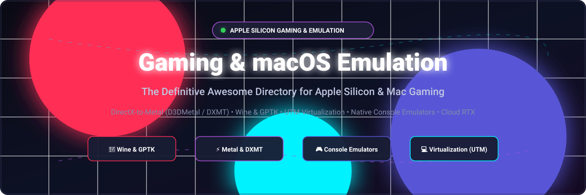

# Awesome-Gaming-Macos-Emulation

  

  

  

  

  

  

# 🍎 Top Gaming & macOS Emulation

**Curated List of SaaS/Commercial Platforms & Open-Source GitHub Projects**  

*Focused on Apple Silicon Windows Translation Layers (Wine/D3DMetal/DXMT/MoltenVK), macOS Virtualization, Native Apple Silicon Game Ports, Console Emulators & Cloud Streaming*  

**Last updated: November 2026**

This repository tracks notable **SaaS/Commercial platforms** and **open-source projects** for **Gaming & macOS Emulation**. These tools power DirectX 9/10/11/12-to-Apple-Metal translation (`DXMT`, `MoltenVK`, `Whisky`, `Kegworks`), Apple Silicon macOS ports (`adrbn/bo2-mac`, `NX2Apple`), lightweight QEMU/Virtualization.framework Windows/Linux VMs (`UTM`), native macOS multi-system emulators (`OpenEmu`, `RetroArch`, `Dolphin`, `PCSX2`, `RPCS3`), and cloud RTX game streaming (`GeForce NOW`, `Boosteroid`, `Shadow`) for Mac gamers and porting engineers.

**Examples** include GeForce NOW (NVIDIA), Parallels Desktop (Alludo / Corel), Shadow PC (OVHcloud / Octave Klaba), Boosteroid, CrossOver Mac (CodeWeavers), UTM (App Store / Hosted Ecosystem), Porting Kit (Paul The Tall / Wineskin Ecosystem), Whisky (Apple GPTK Wrapper Ecosystem), OpenEmu (Hosted Core/App Ecosystem), and RetroArch (Libretro Mac App Store / Web Ecosystem) (the category leaders).

**🚀 Open-source emphasis**: This section is heavily expanded with every major active project for macOS Windows translation & DirectX-to-Metal layers (`DXMT`, `MoltenVK`, `Wine`, `Whisky`, `Kegworks / Wineskin`), Apple Silicon game ports (`adrbn/bo2-mac`, `OpenMW`, `Ship of Harkinian`), macOS virtualization (`UTM`, `Lima`, `QEMU`), and native Metal-accelerated console emulators (`OpenEmu`, `RetroArch`, `Dolphin`, `PCSX2`, `RPCS3`, `Ryujinx` forks) — ideal for Mac gamers seeking native Apple Silicon performance without subscriptions.

🤝 Contributions welcome! Open a PR to add/update entries. Keep descriptions factual and link to official sites.

## 📑 Table of Contents

- [📊 Sector Overview & Market Dynamics](#-sector-overview--market-dynamics)

- [☁️ SaaS/Hosted & Commercial Platforms](#️-saashosted--commercial-platforms)

- [💻 Open-Source GitHub Projects](#-open-source-github-projects)

- [🛠️ How to Contribute](#️-how-to-contribute)

- [⚠️ Disclaimer](#️-disclaimer)

- [💖 Support & Thank You](#-support--thank-you)

## 📊 Sector Overview & Market Dynamics

The global macOS Gaming, Translation Middleware & Cloud Game Streaming market is valued at approximately **$8.2B–$11.0B+ in 2026**, expanding at a ~22%–28% CAGR propelled by Apple Silicon M-series GPU performance, Apple's Game Porting Toolkit (`D3DMetal`), and native Metal 3/4 translation layers. The commercial virtualization and cloud-streaming layer exhibits **strong winner-take-most consolidation** around Parallels Desktop, CrossOver Mac, and NVIDIA GeForce NOW, while the **DirectX-to-Metal translation, Apple Silicon console emulation, and community macOS porting layers are overwhelmingly open-source driven** (`DXMT`, `MoltenVK`, `OpenEmu`, `UTM`, `Kegworks`).

## ☁️ SaaS/Hosted & Commercial Platforms

*Sorted descending by company valuation / annual revenue scale.*

| Platform | Description | Company Scale (Valuation / Revenue) | Starting Paid Tier | Free Tier / Trial Limit |

| :--- | :--- | :--- | :--- | :--- |

| **[GeForce NOW (NVIDIA)](https://nvidia.com)** | Native macOS Apple Silicon cloud RTX game-streaming app running Windows Steam, Epic, Xbox, and GOG libraries at up to 4K/120fps or 1080p/240fps. | **Part of NVIDIA Corp.** (~$130B+ annual revenue; ~$3T+ market cap) | **$9.99 / month** ($49.99/6 mos Performance) or **$19.99 / month** ($99.99/6 mos Ultimate RTX 4080/5080) | **Forever Free Basic Tier** (Ad-supported **1-hour session limit** with standard queue access on native macOS app) |

| **[Parallels Desktop (Alludo)](https://parallels.com)** | Commercial macOS virtualization suite with hardware-accelerated DirectX 11 and OpenGL support for running Windows 11 ARM games smoothly on Apple Silicon. | **Part of Alludo (KKR)** (~$500M+ Alludo group revenue; backed by KKR) | **$99.99 / year** (Standard Edition) or **$119.99 / year** (Pro Edition; $129.99 one-time Standard) | **14-Day Full-Access Free Trial** (Includes full DirectX 11 gaming and Windows 11 ARM virtualization for 14 days; no perpetual free tier) |

| **[Shadow PC (OVHcloud / Octave Klaba)](https://shadow.tech)** | Full cloud Windows 11 gaming PC streamed natively to macOS at low latency for playing any DirectX 12, anti-cheat, or PC-exclusive title. | **Backed by Octave Klaba / OVHcloud** (~€1B+ OVHcloud group revenue) | **$19.99 / month** (Discovery tier) or **$32.99 – $49.99 / month** (Boost / Power RTX GPU tiers) | **No Perpetual Free Tier** (Occasional first-month promotional discounts; full Windows cloud VM requires active subscription) |

| **[Boosteroid](https://boosteroid.com)** | Native macOS and browser cloud gaming service streaming AAA Windows titles at up to 4K/120fps across European and North American data centers. | **~$100M–$200M Est. Valuation** (~$20M–$40M est. ARR; rapid EU/US server expansion) | **€7.49 / month** billed annually (€89.89/yr) or **€9.89 / month** monthly for Ultra 4K | **No Perpetual Free Tier** (Free account enables latency/bitrate connection tests on macOS prior to subscribing) |

| **[CrossOver Mac (CodeWeavers)](https://codeweavers.com)** | Premier commercial Wine + D3DMetal + DXMT + MoltenVK compatibility layer running thousands of Windows Steam/GOG games natively on macOS without a VM. | **~$10M–$25M Est. Scale** (Profitable employee-owned primary corporate sponsor of Wine) | **$74.00 / year** (12 months of updates & support; perpetual use of downloaded version) or **$494 one-time** Life license | **14-Day Full-Access Free Trial** (Unlimited Windows game testing on macOS for 14 days with full D3DMetal/DXMT support) |

| **[Porting Kit (Paul The Tall / Wineskin Ecosystem)](https://portingkit.com)** | Free macOS game-porting database and automated wrapper builder configuring Wine, DXVK, D3DMetal, and GOG/Steam installers with 1-click recipes. | **Community & Indie Maintainer Ecosystem** (Donation & Patreon supported) | **$0 / Free Software** (Optional Patreon tiers for early wrapper recipes) | **100% Free Forever** (Unlimited automated Wine/Wineskin macOS game wrappers and curated compatibility database) |

| **[UTM (Mac App Store / Virtualization Ecosystem)](https://getutm.app)** | Full-featured macOS system emulator and Apple Virtualization.framework host running Windows 11 ARM, classic x86 Windows XP/98, and Linux VMs. | **Community Open-Source Project** (Apache-2.0; optional $9.99 Mac App Store convenience build) | **$0 / Free GitHub Download** (**$9.99 one-time** optional Mac App Store purchase for automatic updates) | **100% Free Forever** (Identical full-featured binary downloadable 100% free from GitHub/website with zero restrictions) |

| **[Whisky (Apple GPTK Wrapper Ecosystem)](https://getwhisky.app)** | Sleek native SwiftUI macOS wrapper around Wine and Apple's Game Porting Toolkit (`D3DMetal`) for running DirectX 11/12 Windows games effortlessly. | **Community Open-Source Project** (GPL-3.0; maintained by Isaac Marovitz & community) | **$0 / Free Open-Source** (Zero subscription fees, ads, or paywalls) | **100% Free Forever** (Unlimited Steam/Windows bottles with 1-click DXVK, D3DMetal, and MSync toggles on Apple Silicon) |

| **[OpenEmu (Hosted Core & macOS Ecosystem)](https://openemu.org)** | Iconic native Cocoa macOS multi-system emulator frontend featuring cover-art shelves, shader pipelines, and 30+ console cores out of the box. | **Community Open-Source Project** (BSD-3-Clause; gold-standard Mac emulation app) | **$0 / Free Open-Source** (100% free macOS native application) | **100% Free Forever** (Unlimited native macOS emulation for NES, SNES, N64, PS1, PSP, GBA, DS, Sega, and Arcade systems) |

| **[RetroArch (Libretro Mac App Store / Web Ecosystem)](https://retroarch.com)** | Universal Apple Silicon & Intel macOS frontend for Libretro cores supporting Metal shaders, rollback netplay, and iCloud/Steam save sync. | **Non-Profit / Community Open-Source Project** (Patreon & bounty funded) | **$0 / Free Open-Source** (Free on macOS DMG, Steam, and Mac/iOS App Store) | **100% Free Forever** (Unlimited Metal-accelerated emulator cores, Slang CRT shaders, and run-ahead latency reduction) |

## 💻 Open-Source GitHub Projects

| Project | License / Hosting Cost | Free Tier / Self-Hosted Limit | Description |

| :--- | :--- | :--- | :--- |
